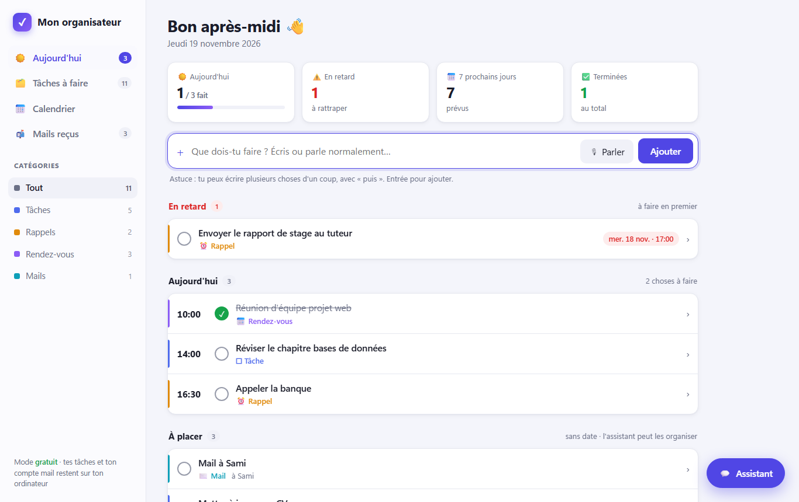
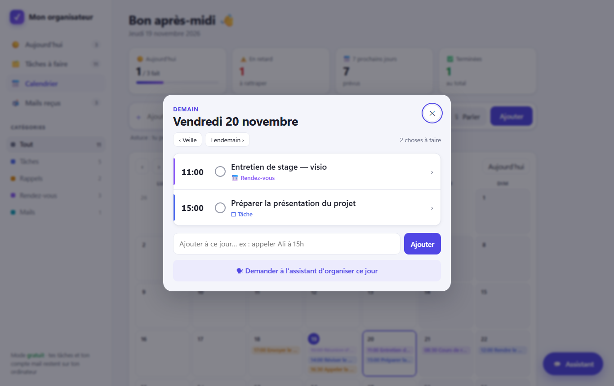
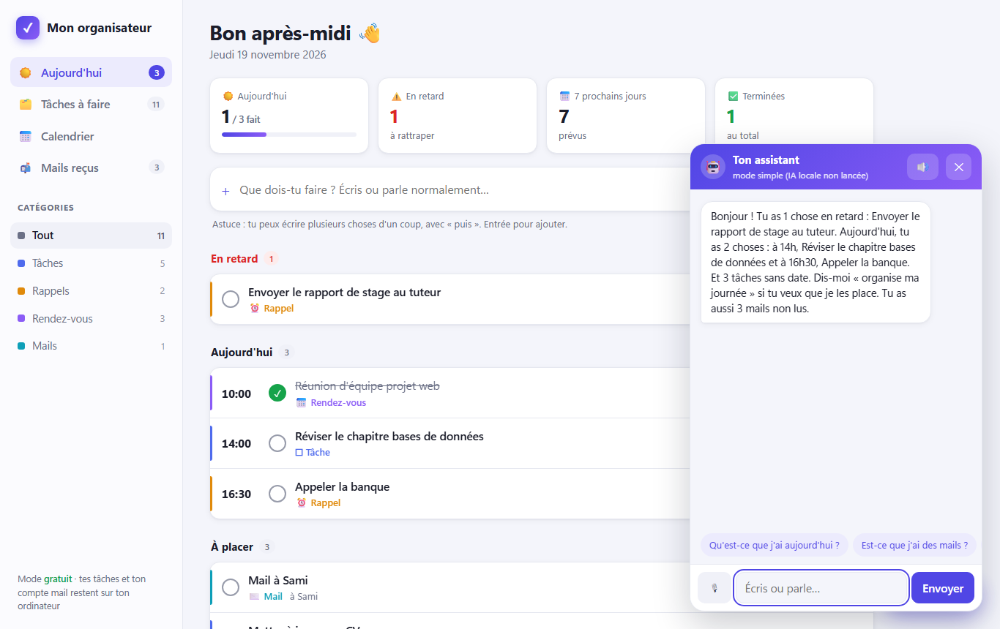
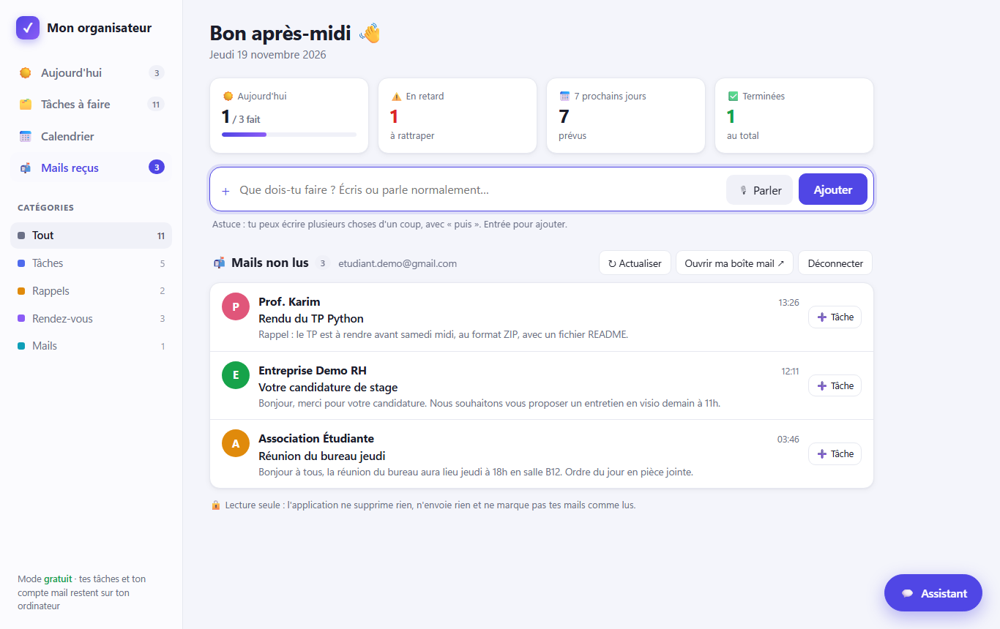
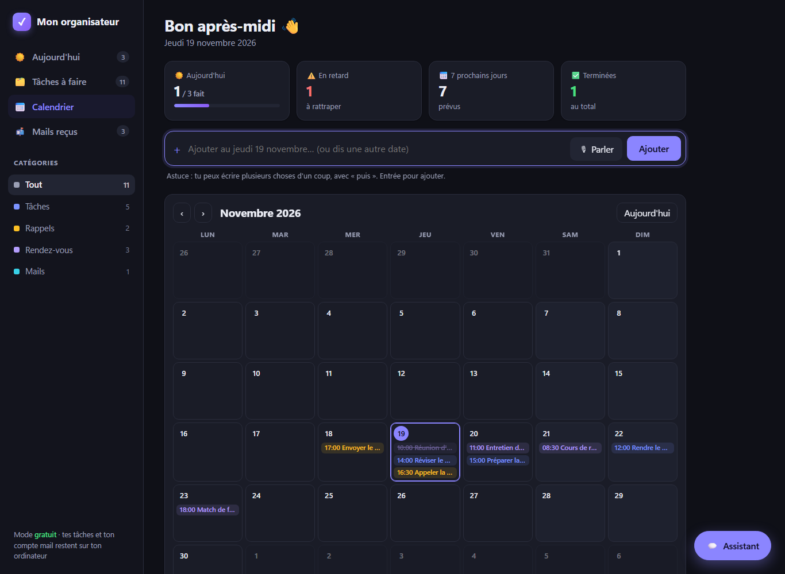
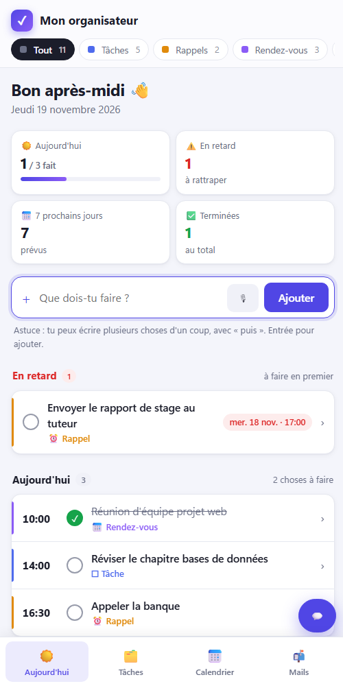
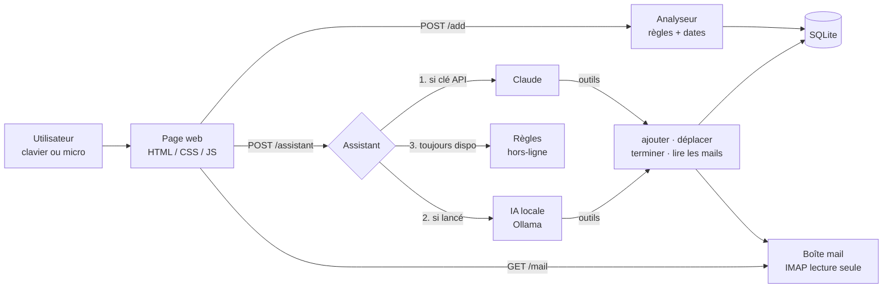

#  Mon organisateur

**Application web d'organisation du travail, en français.**
On écrit — ou on **dit** — ce qu'on a à faire, en langage naturel. L'application le comprend, le range
toute seule (tâches, rappels, rendez-vous, brouillons de mails) et un **assistant vocal** aide à organiser
la journée, annonce les rappels et lit les nouveaux mails.




> « Rappelle-moi d'appeler le fournisseur demain à 10h, puis réunion avec Sami lundi à 14h30 »
> → **1 rappel** demain à 10:00 + **1 rendez-vous** lundi à 14:30, rangés et affichés dans le calendrier.

---

##  Fonctionnalités

| | |
|---|---|
|  **Saisie naturelle** | Une seule zone pour écrire ou dicter (micro). Plusieurs choses d'un coup avec « puis ». Les dates relatives (« demain », « lundi », « dans 2 heures ») sont comprises. |
|  **Vue « Aujourd'hui »** | Ce qui est en retard, la journée heure par heure, les tâches à placer et un aperçu de demain, avec une barre de progression. |
|  **Calendrier** | Vue du mois ; un clic sur un jour l'ouvre en grand pour cocher, modifier ou ajouter directement à cette date. |
|  **Assistant vocal** | Répond à voix haute : « qu'est-ce que j'ai demain ? », « organise ma journée » (il propose des horaires et les applique si on dit « oui »), « décale le rapport à 15h ». |
|  **Rappels parlés** | 10 minutes avant un rendez-vous, puis à l'heure : message, notification et voix. |
|  **Mails** | Connexion à sa boîte (Gmail, Yahoo, iCloud… via IMAP) avec un guide pas à pas. Les mails non lus s'affichent, deviennent des tâches en un clic, et l'assistant annonce les nouveaux. **Lecture seule.** |
|  **IA locale gratuite** *(expérimental)* | L'assistant peut utiliser un modèle d'IA qui tourne sur l'ordinateur (Ollama) — aucune donnée envoyée, aucun coût. Sans IA, il fonctionne avec des règles. |
|  **Partout** | Mode sombre automatique, version téléphone avec barre d'onglets, export `.ics` vers Google / Outlook / Apple Agenda. |

##  Captures d'écran

| Un jour ouvert en grand | L'assistant vocal |
|---|---|
|  |  |
| **Mails reçus** | **Calendrier en mode sombre** |
|  |  |

<p align="center"></p>

*Captures réalisées avec des données de démonstration.*

##  Technologies

| Partie | Outils |
|---|---|
| Serveur | **Python**, **FastAPI**, Pydantic, Uvicorn |
| Données | **SQLite** (module standard `sqlite3`) |
| Interface | **HTML / CSS / JavaScript** sans framework, design responsive, mode sombre |
| Voix | **Web Speech API** du navigateur (reconnaissance + synthèse vocale en français) |
| Compréhension du texte | Analyseur par règles et expressions régulières (dates relatives, type d'élément) |
| IA | **Ollama** (modèle local, gratuit) avec appels d'outils ; Claude (API Anthropic) en option |
| Mails | **IMAP** (`imaplib`, module `email`) en lecture seule |
| Qualité | **pytest** (40 tests), faux serveur IMAP et fausse IA pour tester sans réseau |
| Outils de dev | Git, GitHub, assistant de programmation IA (Claude Code) |

##  Architecture



Points clés :
- **Dégradation propre** : si l'IA ne répond pas, l'assistant repasse tout seul sur les règles — l'application ne casse jamais.
- **L'IA n'invente rien** : elle agit uniquement via des outils (ajouter, modifier, lire les mails) et reçoit l'état à jour de l'application à chaque message. Les dates des jours suivants lui sont données toutes prêtes, car les petits modèles se trompent souvent dans les calculs de dates.
- **Mails en lecture seule** : boîte ouverte en `readonly`, messages lus avec `BODY.PEEK` (ils restent « non lus »). Un test le vérifie.

##  Essayer l'application

**Le plus simple (Windows)** : installer [Python](https://www.python.org/downloads/) en cochant *Add Python to PATH*,
télécharger le projet (**Code → Download ZIP**), l'extraire, puis **double-cliquer sur `Lancer-application.bat`**.
La première fois, il installe ce qu'il faut (1 à 2 minutes), puis l'application s'ouvre dans le navigateur.

**À la main** (Windows, macOS, Linux) :

```bash
pip install -r requirements.txt
python -m uvicorn app.main:app --port 8001
```

Puis ouvrir <http://localhost:8001> dans **Chrome** ou **Edge** (nécessaires pour la dictée vocale).

**Assistant plus intelligent (optionnel, gratuit, expérimental)** : installer [Ollama](https://ollama.com),
télécharger un modèle qui gère les appels d'outils, et indiquer son nom dans la variable `OLLAMA_MODEL`
(voir `.env.example`). Sans ce réglage, l'assistant reste en mode rapide (règles). Si l'IA met plus de 20 secondes,
l'assistant répond quand même en mode rapide : il ne reste jamais bloqué.

**Lancer les tests** :

```bash
pytest
```

##  Vie privée et gratuité

- Tout tourne **sur l'ordinateur** : les tâches sont dans `data/organizer.db`, le compte mail dans `data/mail.json`
  (dossier exclu de Git).
- **Aucun service payant n'est nécessaire.** La clé API Claude est optionnelle (voir `.env.example`).
- La dictée vocale utilise le service de reconnaissance de Chrome / Edge.

##  Ce que j'ai appris

- Concevoir une **API REST** avec FastAPI et Pydantic (validation, codes d'erreur, routes CRUD).
- Analyser du **langage naturel en français** avec des règles et des expressions régulières, et calculer des dates relatives.
- Intégrer un **modèle d'IA avec appels d'outils** (local avec Ollama, ou Claude), et garder un mode de secours fiable.
- Utiliser les **API du navigateur** : reconnaissance et synthèse vocale, notifications, stockage local.
- Lire une boîte mail en **IMAP** de façon sûre (lecture seule, mot de passe d'application, gestion des erreurs).
- Écrire des **tests automatisés** avec pytest, en simulant les services externes (faux serveur IMAP, fausse IA).
- Soigner l'**expérience utilisateur** : interface responsive, mode sombre, annulation, messages d'erreur clairs en français.

##  Prochaines étapes

- [ ] Comptes utilisateurs, pour pouvoir mettre l'application en ligne
- [ ] Transcription vocale côté serveur (Whisper) pour tous les navigateurs
- [ ] Dates absolues (« le 20 novembre ») et arabe tunisien / franco-arabe
- [ ] Synchronisation avec Google Agenda

<details>
<summary><b>API (pour les développeurs)</b></summary>

| Méthode | Route | Rôle |
|---|---|---|
| `POST` | `/add` | Analyse une phrase et enregistre les éléments (`text`, `now`, `day` optionnel) |
| `POST` | `/parse` | Analyse seulement, sans enregistrer |
| `GET` | `/items` | Liste les éléments |
| `PATCH` | `/items/{id}` | Modifie (titre, date, type, `done`…) |
| `DELETE` | `/items/{id}` | Supprime |
| `GET` | `/items/{id}/ics` | Export agenda `.ics` |
| `POST` | `/assistant` | Discussion avec l'assistant (`message`, `conversation_id`) |
| `GET` | `/assistant/briefing` | Résumé parlé de la journée |
| `GET` | `/mail` | Mails non lus (lecture seule) |
| `POST` / `DELETE` | `/mail/connect` | Connecter / déconnecter la boîte mail |

Liens directs vers l'interface : `/?view=calendrier`, `/?view=mails`, `/?day=2026-11-20`, `/?assistant`.

</details>

---

Projet réalisé par **[kounouz5](https://github.com/kounouz5)**, étudiant·e en 3ᵉ année d'informatique. Licence [MIT](LICENSE).
